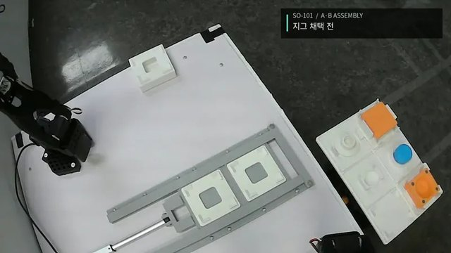
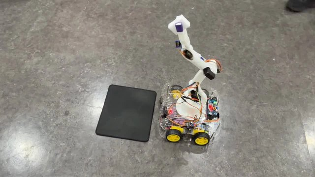
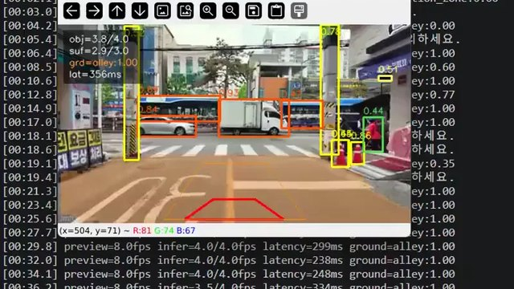
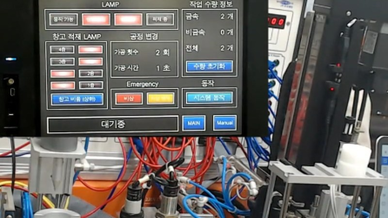
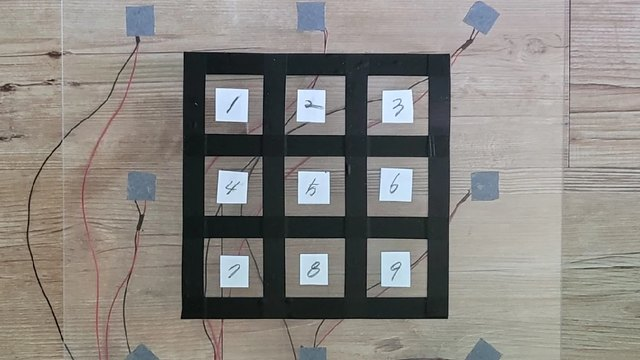
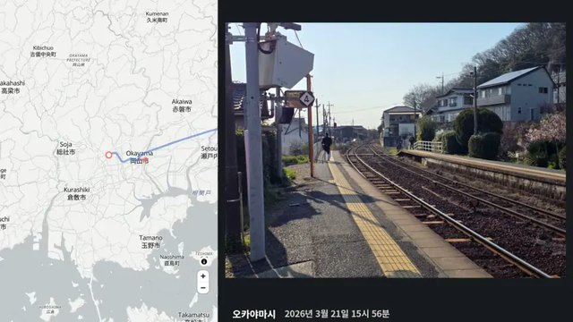

# 정승호 · Seungho Jung

### 로봇 제어 · 비전 · 임베디드

펌웨어부터 로봇팔 제어, 비전 모델 실행까지 직접 만들고 확인합니다.

### [포트폴리오 사이트 ↗](https://sditr0414.github.io/)

---

## 기술

### 제어·임베디드

### 로봇·비전

### 설계·개발 도구

---

## 프로젝트

<table>
<tr>
<td width="50%" valign="top">

<h3>비전 기반 로봇팔 조립·검사</h3>

지그 위치를 다시 측정해 동작을 보정하고, 부품 종류와 안착 상태를 검사

<code>Python · ROS2 · OpenCV · YOLO</code>

<a href="https://sditr0414.github.io/#opencv">상세 보기</a> &nbsp;·&nbsp; <a href="https://github.com/7s-FA/opencv-teach">코드</a>

</td>
<td width="50%" valign="top">

<h3>원격 물품 회수·운반 로봇</h3>

스마트폰으로 주행과 로봇팔을 조작하고, 저장한 동작을 재생하는 4륜 로봇

<code>C · STM32F411 · FreeRTOS</code>

<a href="https://sditr0414.github.io/#robot">상세 보기</a> &nbsp;·&nbsp; <a href="https://github.com/sditr0414/mobile-retrieval-robot">코드</a>

</td>
</tr>
<tr>
<td width="50%" valign="top">

<h3>AI 기반 보행 보조 장치</h3>

객체 검출과 지면 분할로 보행 경로의 위험을 음성으로 안내

<code>Python · YOLO · TFLite · Raspberry Pi5</code>

<a href="https://sditr0414.github.io/#vision">상세 보기</a> &nbsp;·&nbsp; <a href="https://github.com/sditr0414/GreenLight">코드</a>

</td>
<td width="50%" valign="top">

<h3>PLC 기반 창고 적재 제어</h3>

금속·비금속 소재를 판별해 1~4층 창고에 병렬로 적재

<code>Mitsubishi Q PLC · GX Works2</code>

<a href="https://sditr0414.github.io/#plc">상세 보기</a>

</td>
</tr>
<tr>
<td width="50%" valign="top">

<h3>노크 위치 탐지 연구</h3>

피에조 센서 8개의 진동 신호로 두드린 위치를 9개 구역으로 분류

<code>MATLAB · K-NN · SVM · ANN</code>

<a href="https://sditr0414.github.io/#thesis">상세 보기</a>

</td>
<td width="50%" valign="top">

<h3>Travel Visualizer</h3>

여행 사진과 이동 기록을 지도 위 경로로 잇는 웹앱

<code>React · TypeScript · MapLibre</code>

<a href="https://sditr0414.github.io/#travel">상세 보기</a> &nbsp;·&nbsp; <a href="https://github.com/sditr0414/Travel-Visualizer">코드</a>

</td>
</tr>
</table>

---

## 학력·교육

- **대한상공회의소 서울기술교육센터** · AI융합 로봇 SW개발자 3기 수료 (2026.04 – 2026.11)
- **순천향대학교 기계공학과** 졸업 (2019.03 – 2026.02)
